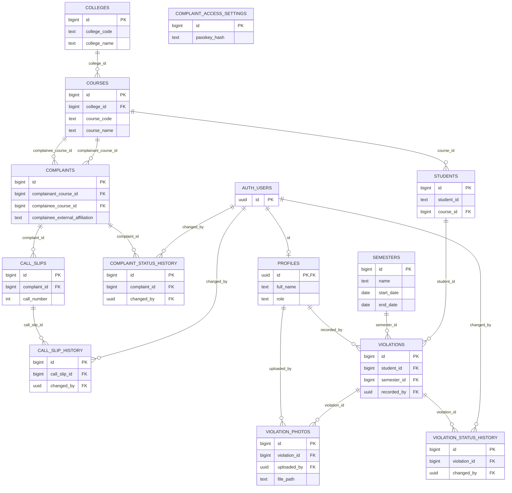

# CSUPAK entity-relationship diagram

Derived from the 17 foreign-key constraints in the live public schema dump. `auth.users` is Supabase-managed and is **not** defined by `baseline.sql`. This diagram shows relationships, not every table column or every constraint.

`COMPLAINT_ACCESS_SETTINGS` has no foreign-key relationship to other public tables. Optional foreign keys are represented schematically; inspect `baseline.sql` for exact nullability and deletion behavior.
